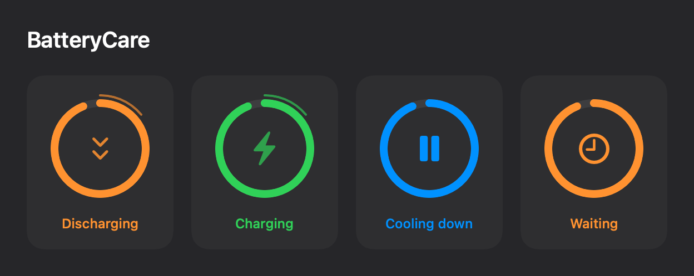

[English](./README.md) · [简体中文](./README.zh-CN.md) · [繁體中文](./README.zh-TW.md) · [日本語](./README.ja.md)

<div align="center">
  
  <h1>BatteryCare</h1>
  <p><strong>バッテリーの状態をひと目で。電源の制御を、ていねいに。</strong></p>
  <p>残量、温度、電源制御を半透明のパネルにまとめた、軽量な macOS ネイティブのメニューバーアプリ。</p>
  <p>
    
    
    
    
  </p>
  <p>
    <a href="#overview">概要</a> ·
    <a href="#features">機能</a> ·
    <a href="#workflows">利用シーン</a> ·
    <a href="#quick-start">クイックスタート</a> ·
    <a href="#architecture">構成</a> ·
    <a href="#docs">ドキュメント</a>
  </p>
</div>

---

<a id="overview"></a>
## ✨ BatteryCare について

ターミナルの操作や、別のバックグラウンドサーバーは不要です。残量、実際の充電状態、温度、バッテリーの状態、自動放電を、すりガラス風の素材とコンパクトなカードを使ったメニューバーアプリで確認・操作できます。

もともとは `battery.py` から始まったツールですが、現在のバージョンは Swift actor で監視と制御をアプリ内に統合しています。管理者権限が必要なハードウェア操作のみ、同梱の Go ヘルパーが担当します。**実行時に Python、HTTP サービス、別途インストールする LaunchDaemon は必要ありません。**

> **ご利用前に：** Apple 公式製品ではなく、バッテリー寿命の延長を保証するものではありません。自動放電は CPU 負荷・発熱・充放電サイクルを増やす機能であり、一般的な「充電上限」機能とは異なります。初期状態はオフで、アプリを再起動するたびにオフになります。[安全上の注意](./docs/SECURITY.md)（簡体字中国語）を読み、無人運転や重要な作業中は有効にしないでください。

<a id="features"></a>
## 🚀 主な機能

### 🔋 実際の状態をわかりやすく

- メニューバーに残量を表示。左クリックでパネル、右クリックでクイック操作・設定・終了を開きます。
- 稲妻マークは、システムが**実際に充電中と報告した場合のみ**表示します。自動放電のオン・オフとは連動しません。
- 温度やバッテリーの状態を確認できます。センサーから取得できない値を架空の数値で補うことはありません。
- パネルをメニューバーのボタンに合わせ、使用中の画面内に配置します。高さが足りない画面ではスクロールできます。
- 自動放電中は下向きの流れる矢印、充電中は稲妻、冷却中は一時停止、待機中は時計を表示します。円の進捗は実際の残量です。アニメーションはパネル表示中のみ最大 15 fps で動き、「視差効果を減らす」に対応します。



### 🎛️ しきい値と温度保護

- 放電の開始・停止しきい値、温度上限、冷却待機時間、制御の確認間隔を設定できます。
- 上限に達したら電源アダプタの切断を確認してから、CPU のみの適応型負荷を開始します。下限に達したら負荷を止め、アダプタを復旧します。
- ワーカーは最大 4、論理コアの半分まで（最低 1）。徐々に負荷を増やし、各ワーカーの目標稼働率は最大 85% です。CPU の停止温度は設定値と 75°C の低い方で、システムの熱状態に応じて負荷を減らすか停止します。GPU・ディスク・大容量メモリへの負荷は追加しません。これは保守的なソフトウェア上の制限であり、摩耗ゼロの保証ではありません。
- 残量と温度は 5 秒ごとに取得し、バッテリーの状態は 5 分間キャッシュします。安全停止は通常の確認間隔を待ちません。
- 高温、低残量、センサー情報の欠落時は負荷を停止または一時停止します。CPU ワーカーとスリープ防止にはタイムアウトを設けています。

### 🧩 サービスをアプリに内蔵

- UI・監視・負荷は一般ユーザー権限で動作し、管理者権限は同梱のハードウェアヘルパーに限定します。
- 専用 Unix ソケット、セッショントークン、固定コマンドを使用し、HTTP 制御ポートは開きません。
- 通常の終了時は負荷とスリープ防止を停止し、電源アダプタの復旧を試みます。ヘルパーも親プロセスの消失とハートビートの期限切れを監視します。
- 本プロジェクトの旧 `com.local.battery-service` は、バックアップ後に無効化して移行できます。他の Homebrew サービスは削除しません。

### 🌏 4 言語を切り替え

- **English・简体中文・繁體中文・日本語**に対応しています。
- **設定 → 言語**から変更できます。パネル、メニュー、メッセージ、ウインドウのタイトルにすぐ反映され、再起動は不要です。
- 初回はシステムの優先言語を参照し、対応言語がなければ英語を使用します。手動で選んだ言語は保存され、次回以降も優先されます。
- 言語を変えても、電源制御、自動放電の状態、しきい値、保存前の編集内容は変わりません。

### 🎨 ネイティブの質感と多彩なロゴ

- SwiftUI + AppKit の半透明 UI がシステムの外観に対応します。
- パールホワイトの角丸背景に、虹色の電池と白い稲妻を配置したオリジナルアイコン。SVG・PNG・ICNS を同梱しています。
- 初回は可能な範囲で右側のシステムアイコン付近に配置し、⌘ を押しながらドラッグした位置を記憶します。**設定 → メニューバーの位置 → 右側に配置** から、監視を再起動せずにリセットできます。最終的な順序は macOS が決定するため、標準バッテリーの真隣になるとは限りません。
- ログイン時の起動に対応。システムのバッテリーアイコン設定への入口も用意していますが、**非表示への変更はシステム設定でユーザー自身が行います**。

<a id="workflows"></a>
## 💡 利用シーン

| シーン | できること |
| --- | --- |
| 日常の状態確認 | ハードウェア制御を認証せず、残量・充電・温度・バッテリーの状態を確認。 |
| 意図的な放電サイクル | リスクを理解し、しきい値を設定して明示的に認証したうえで自動放電を有効化。 |
| アイコンの重複を減らす | システム設定を開き、標準のバッテリーアイコンを手動で非表示に。 |
| Python 版からの移行 | 設定画面から旧サービスをバックアップして移行し、内蔵エンジンに切り替え。 |
| 表示言語を変更 | 設定で言語を選択。即時反映され、次回起動時も保持。 |

<a id="quick-start"></a>
## ⚡ クイックスタート

### ソースを取得してビルド

**開発環境：** macOS、Xcode Command Line Tools（Swift とシステム SDK）、Go 1.25 以降。ビルド時の plist 生成にはシステムの Python 3 を使用しますが、**完成したアプリの実行に Python は不要**です。Go の依存ソースは vendor に含まれており、モジュールのダウンロードは不要です。

```bash
git clone https://github.com/minskiter/BatteryCare.git
cd BatteryCare
./test.sh
./build.sh
open dist/BatteryCare.app
```

ホストのアーキテクチャ向けに、macOS 13 を最小対象としてビルドします。Universal Binary ではありません。Apple Silicon でビルドと分離テストを確認していますが、**Intel および対象となるすべての macOS バージョンでの実機検証は完了していません**。SMC 制御には対応するハードウェアキーが必要です。未対応の場合は処理を続けず、エラーとして報告します。

ビルドはローカルの ad-hoc 署名であり、Developer ID による署名や公証はありません。ダウンロードしたファイルを動かすためにシステムの安全機能を無効にしないでください。他の Mac へ配布する場合は、正式な署名、公証、対象機器での検証が必要です。

### 初回の操作

1. アプリを開き、メニューバーのバッテリーアイコンをクリックします。Dock アイコンは表示しません。
2. **設定 → 言語**から表示言語を選択します。
3. ハードウェア制御が必要な場合は **電源制御の移行／認証…** を選び、システムの管理者認証を承認します。
4. しきい値と温度上限を確認し、警告を読んだうえで必要な場合のみ自動放電を有効にします。
5. 標準アイコンを隠す場合は、設定の入口からシステム設定を開いて変更します。項目の場所は macOS によって異なります。
6. 設定ウインドウを閉じても監視は続きます。終了を選ぶと監視を停止し、後処理を実行します。

**BatteryBar／BatteryCare 2.1 からの更新：** 旧アプリのログイン項目を無効にして通常終了してから置き換えてください。2.2 は bundle ID `com.local.batterycare` と `~/Library/Application Support/BatteryCare/config.json` を使用します。有効な旧設定と未設定の言語・メニューバー位置を移行しますが、新しい設定を上書きせず、自動放電も再開しません。最終的な場所にインストールしてから新アプリのログイン項目を有効にしてください。新しい ID は旧ログイン項目を自動削除しません。実行中は移動しないでください。

<a id="architecture"></a>
## 🏗️ 技術と構成

```text
メニューバー / 半透明パネル（一般ユーザー権限）
                      │
               Swift actor 内蔵エンジン
                ├── システムの電池情報 / 同梱 iSMC 温度取得
                ├── しきい値 / CPU 負荷 / スリープ防止
                └── トークン認証付き Unix ソケット
                                  │
                        BatteryHardware（管理者権限）
                          固定コマンド → SMC 電源制御
```

| レイヤー | 技術と役割 |
| --- | --- |
| UI | SwiftUI、AppKit、NSStatusItem、位置を指定する NSPanel |
| エンジン | Swift concurrency、IOKit、状態取得、ヒステリシス制御、ライフサイクル |
| ヘルパー | Go、gosmc、専用ソケット、親プロセスの検証、復旧リース |
| 温度取得 | 同梱ソースからビルドする独立した iSMC 実行ファイル |
| 言語 | 4 言語の JSON カタログ、選択の保存、即時更新 |
| 起動・配布 | SMAppService、ローカルビルド、ad-hoc 署名 |

### ディレクトリ構成

```text
Sources/                 # UI、エンジン、多言語化、アイコン描画
Resources/Localizations/ # en / zh-Hans / zh-Hant / ja の UI 文字列
Hardware/                # 制限付きヘルパー、テスト、依存ソース（GPL-2.0）
Dependencies/iSMC/        # 温度ツールと依存ソース（GPL-3.0）
tests/                   # モデル、アイコン、配置、エンジン、多言語化テスト
assets/                  # SVG / PNG / ICNS のブランド素材
docs/                    # 安全、設計、開発の説明
README*.md               # 英語、簡体字中国語、繁体字中国語、日本語
build.sh                 # 自己完結型 App をビルド。システムサービスは設置しない
test.sh                  # Go race detector と分離した Swift テスト
dist/                    # ローカル生成物。Git 管理対象外
```

<a id="docs"></a>
## 📚 ドキュメントと安全上の限界

以下の詳細文書は現在、簡体字中国語です。4 言語の README には導入手順、言語の切り替え、主なリスク、互換性の制限を記載しています。

| 文書 | 内容 |
| --- | --- |
| [安全上の注意](./docs/SECURITY.md) | 権限、CPU 負荷のリスク、復旧と制限 |
| [開発ガイド](./docs/DEVELOPMENT.md) | ビルド、テスト、多言語化、互換性、配布 |
| [設計](./docs/DESIGN.md) | オリジナルロゴ、質感、状態アイコンの意味 |
| [第三者ライセンス](./THIRD_PARTY_NOTICES.md) | 独立した実行ファイルと依存ソースのライセンス（英語） |

**電源アダプタの復旧は、充電の強制ではありません。** macOS、ハードウェア、他のバッテリーツールによって充電が制限されることがあります。復旧はソフトウェアによるベストエフォートであり、停電、ハードウェア故障、ヘルパーの強制終了などを保証するものではありません。複数のツールから電源アダプタを同時に制御しないでください。

<a id="contributing"></a>
## 🤝 コントリビューション

Issue と Pull Request を歓迎します。`./test.sh` と `./build.sh` を実行し、アーキテクチャ、macOS バージョン、変更範囲、検証方法を記載してください。UI 文字列を追加する場合は、4 言語のカタログと README を更新してください。ハードウェア制御の変更には失敗時の挙動と復旧方法を説明し、自動テストでは mock を使って CI から実際の SMC に書き込まないでください。

個人設定、管理者パスワード、セッショントークン、実行ログ、秘密鍵、署名用認証情報をコミットしないでください。報告内容は事前に匿名化してください。[貢献ガイド](./CONTRIBUTING.md)（簡体字中国語）も参照してください。

## 📄 ライセンスと謝辞

第一者の Swift コード、文書、オリジナル素材は [GPL-3.0-or-later](./LICENSE) です。`Hardware/` ヘルパーは [GPL-2.0](./Hardware/LICENSE)、`Dependencies/iSMC/` と各 vendor ディレクトリはそれぞれのライセンスを保持します。[第三者ライセンス](./THIRD_PARTY_NOTICES.md)を確認してください。これらは別々にビルドし、IPC やサブプロセスで通信するプログラムであり、ソース全体を MIT として扱うことはできません。

[gosmc](https://github.com/charlie0129/gosmc) と [iSMC](https://github.com/dkorunic/iSMC) に感謝します。macOS のネイティブな質感や BetterDisplay のメニューバー操作を参考にしていますが、Apple や BetterDisplay の商標図形・ソースコードは使用していません。BatteryCare は独立したプロジェクトです。

### 自動放電中の画面点灯維持

自動放電が有効で電池残量・温度の監視が正常な間、アイドルによる画面消灯とシステムスリープを一時的に防ぎます。上限待機中も対象です。既に消灯した画面の点灯、AC電源の偽装、グローバル電源設定の変更、蓋を閉じた際・手動・緊急時のスリープの無効化は行いません。低残量、冷却、センサー異常、無効化、ヘルパー切断、終了で解除し、監視停止時は15秒で期限切れになります。電源アダプタ切断中のクラムシェル動作は保証できません。放電中は蓋を開け、蓋を閉じて外部ディスプレイを使う際は自動放電を無効にして外部電源を維持してください。

### ローカルのバッテリー統計（2.3）

パネル下部またはメニューバーの右クリックから「バッテリー統計」を開き、24時間・7日・30日間の累積消費、平均速度、観測時間、サイクル変化と残量グラフを確認できます。健康度は期間選択とは独立した最大180日の日平均です。CSV書き出しと確認付きの履歴消去に対応します。

既存の監視結果を毎分最大1件、`~/Library/Application Support/BatteryCare/history.sqlite3`（0600）に保存し、約365日を超えた行を毎日削除します。送信や過去データの補完は行いません。スリープ、再起動、欠測、3分超の空白は連続観測から除外します。消費はパーセントポイントによる概算で、Whや生涯の実サイクル数ではありません。速度には15分以上・2ポイント以上の有効なバッテリー放電記録が必要です。保存失敗は安全制御を停止しません。

80%未満の予測は長期実機検証前の保守的な傾向ヒューリスティックです。28日以上の期間・14観測日・2ポイント以上の低下と、全期間・前半・後半の安定した低下傾向が必要です。横ばい、回復、古い記録、不連続、不安定な傾向では日付を表示しません。最初の80%未満の整数値79%を目標とした範囲であり、**信頼区間・保証・劣化を早める根拠ではありません**。サイクル回数の減少で健康度の推定履歴をリセットします。

**2.3.1 配置の修正：** 古いステータス項目を解放し、後続のイベントループで再作成して実際の位置を確認します。監視や放電設定は変更しません。macOSが移動しなかった場合は、その旨と⌘ドラッグでの調整方法を表示します。最終的な順序はmacOSが決定します。
