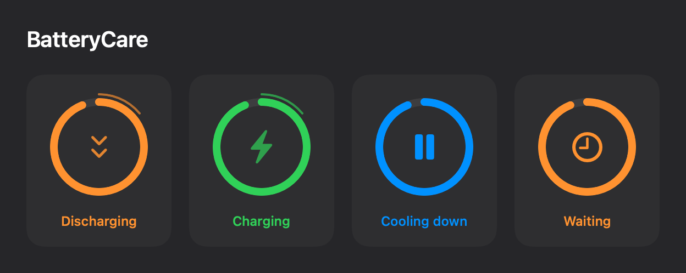

[English](./README.md) · [简体中文](./README.zh-CN.md) · [繁體中文](./README.zh-TW.md) · [日本語](./README.ja.md)

<div align="center">
  
  <h1>BatteryCare</h1>
  <p><strong>Battery status at a glance. Power control with care.</strong></p>
  <p>A lightweight native macOS menu bar app for battery status, temperature and power control in one translucent panel.</p>
  <p>
    
    
    
    
  </p>
  <p>
    <a href="#overview">Overview</a> ·
    <a href="#features">Features</a> ·
    <a href="#workflows">Use cases</a> ·
    <a href="#quick-start">Quick start</a> ·
    <a href="#architecture">Architecture</a> ·
    <a href="#docs">Documentation</a>
  </p>
</div>

---

<a id="overview"></a>
## ✨ Meet BatteryCare

No terminal juggling or separate background server. BatteryCare brings battery percentage, actual charging status, temperature, health and auto-discharge controls into a native menu bar app with frosted materials, compact cards and clear icons.

Originally a `battery.py` utility, the current app runs its monitoring and control loop in a Swift actor. A bundled Go helper handles hardware operations that require administrator authorization. **Running the app needs no Python, HTTP service or separately installed LaunchDaemon.**

> **Know the limits:** BatteryCare is not an Apple product and does not guarantee longer battery life. Auto discharge actively adds CPU load, heat and battery cycles; it is **not** a conventional charge-limit feature. It is off by default and remains off whenever the app restarts. Read the [safety notes](./docs/SECURITY.md) (Simplified Chinese), and do not enable it unattended or during critical work.

<a id="features"></a>
## 🚀 Features

### 🔋 Real status, clearly presented

- Battery level in the menu bar; left-click opens the panel, right-click opens quick controls, Settings and Quit.
- The lightning indicator appears **only when the system reports actual charging**, never merely because auto discharge is enabled.
- Battery temperature and health readings, with unavailable sensors shown honestly rather than fabricated values.
- A panel anchored below its menu bar button, constrained to the current display, with scrolling on short screens.
- A live activity gauge: flowing downward chevrons only during active auto discharge, a charging bolt, a cooling pause and a waiting clock. The fill represents real charge. Animation runs at up to 15 fps only while the panel is visible; Reduce Motion uses static symbols.



### 🎛️ Thresholds and thermal protection

- Configurable start/stop thresholds, temperature limit, cooldown and control interval.
- At the upper threshold, the app confirms adapter cutoff before starting an adaptive CPU-only load. At the lower threshold, it stops the load and restores the adapter.
- Up to 4 workers, capped at half the logical cores (minimum 1), with gradual ramp-up and up to 85% target duty per worker. The effective CPU cutoff is the lower of the configured limit and 75°C; OS thermal pressure reduces or stops work. No extra GPU, disk or large-memory workload. These are conservative software budgets, not a zero-wear guarantee.
- Battery and temperature samples every 5 seconds; health cached for 5 minutes. Safety stops do not wait for the normal threshold interval.
- Overheating, low battery or missing sensors stop or pause the load. CPU work and sleep-prevention assertions have timeouts.

### 🧩 Built into the app

- The normal user process runs the UI, monitoring and load; administrator privileges are limited to the bundled hardware helper.
- Private Unix socket, session token and fixed commands; no HTTP control port.
- Normal quit stops the load, releases sleep prevention and attempts adapter recovery. The helper also checks for parent loss and heartbeat expiry.
- Migration for this project's legacy `com.local.battery-service`, with backups before disabling it; unrelated Homebrew services are not removed.

### 🌏 Four interface languages

- **English, 简体中文, 繁體中文 and 日本語**.
- Switch in **Settings → Language**. The panel, menus, messages and window titles update immediately, without restarting.
- First launch follows a supported system preferred language, falling back to English. Your explicit selection is saved and takes priority on later launches.
- Changing language does not change power control, auto discharge, thresholds or unsaved setting edits.

### 🎨 Native materials and a colorful identity

- SwiftUI + AppKit translucent interface, following system appearance.
- Original pearl-white rounded-square icon with a multicolor battery and white bolt; SVG, PNG and ICNS included.
- Starts near the right-hand system icons when possible, and remembers manual ⌘-drag placement. Use **Settings → Menu bar position → Move right** to reset the hint without restarting monitoring. macOS controls the final order; exact adjacency to the system battery is not guaranteed.
- Open at login and a shortcut to system battery icon settings. **Hiding the native icon is a manual action in System Settings.**

<a id="workflows"></a>
## 💡 Use cases

| Scenario | What you can do |
| --- | --- |
| Check the battery | Read level, charging, temperature and health without authorizing hardware control. |
| Run a deliberate discharge cycle | Understand the risks, set thresholds, explicitly authorize control and enable auto discharge. |
| Reduce duplicate menu bar icons | Open System Settings and manually hide the native battery icon. |
| Upgrade from the Python version | Back up and migrate the old service through Settings before using the built-in engine. |
| Use another language | Choose a language in Settings; it applies immediately and is remembered. |

<a id="quick-start"></a>
## ⚡ Quick start

### Get the source and build

**Development requirements:** macOS, Xcode Command Line Tools (Swift and the system SDK), and Go 1.25+. The build script uses system Python 3 to generate a plist; **the finished app does not need Python at runtime**. Go dependencies are vendored, so builds do not need to download modules.

```bash
git clone https://github.com/minskiter/BatteryCare.git
cd BatteryCare
./test.sh
./build.sh
open dist/BatteryCare.app
```

The script builds for the host architecture with a macOS 13 minimum target, not a Universal Binary. Builds and isolated tests have been verified on Apple Silicon; **Intel and every supported macOS version have not been tested on physical devices**. SMC control requires supported hardware keys; unsupported hardware should report an error rather than proceed.

Builds are locally ad-hoc signed, without Developer ID signing or notarization. Do not disable system security checks to run downloaded files. Cross-machine distribution requires proper signing, notarization and target-device testing.

### First run

1. Open the app and click its menu bar battery icon. There is no Dock icon.
2. Open **Settings → Language** to choose your interface language.
3. When hardware control is needed, choose **Migrate / Authorize power control…** in Settings and approve the system administrator prompt.
4. Check thresholds and the temperature limit. Enable auto discharge only after reading the warning; otherwise leave it off.
5. To hide the native battery icon, use the Settings shortcut and change it yourself in System Settings. Its location varies by macOS version.
6. Closing Settings keeps the app running. Choose Quit to stop monitoring and perform cleanup.

**Upgrading from BatteryBar / BatteryCare 2.1:** disable the old app's login item and quit it normally before replacing it. Version 2.2 uses bundle ID `com.local.batterycare` and `~/Library/Application Support/BatteryCare/config.json`. It imports valid old BatteryBar settings and missing language/menu-position preferences without overwriting new choices or resuming auto discharge. Install at the final location, then enable the new login item. The new bundle does not automatically unregister the old identity. Do not move a running app.

<a id="architecture"></a>
## 🏗️ Technology and architecture

```text
Menu bar / translucent panel (normal user)
                  │
         Built-in Swift actor engine
          ├── System battery data / bundled iSMC temperature reader
          ├── Threshold policy / bounded CPU load / sleep assertion
          └── Token-authenticated Unix socket
                           │
                 BatteryHardware (administrator)
                   Fixed commands → SMC adapter control
```

| Layer | Responsibilities |
| --- | --- |
| Interface | SwiftUI, AppKit, NSStatusItem, anchored NSPanel |
| Engine | Swift concurrency, IOKit, sampling, hysteresis and lifecycle |
| Hardware helper | Go, gosmc, private socket, parent identity checks and recovery lease |
| Temperature | Separate iSMC executable built from included source |
| Language | Four complete JSON catalogs, saved selection, live UI updates |
| Login / distribution | SMAppService, local build and ad-hoc signing |

### Repository layout

```text
Sources/                 # Native UI, engine, localization and icon renderer
Resources/Localizations/ # en / zh-Hans / zh-Hant / ja UI catalogs
Hardware/                # Restricted helper, tests and vendored dependencies (GPL-2.0)
Dependencies/iSMC/        # Temperature tool and full dependencies (GPL-3.0)
tests/                   # Model, icon, placement, engine and localization tests
assets/                  # SVG / PNG / ICNS branding
docs/                    # Safety, design and development notes
README*.md               # English, Simplified Chinese, Traditional Chinese and Japanese
build.sh                 # Build a self-contained app; no system service installation
test.sh                  # Go race detector and isolated Swift tests
dist/                    # Local output; not tracked in Git
```

<a id="docs"></a>
## 📚 Documentation and safety boundaries

The detailed supporting documents below are currently in Simplified Chinese. All four READMEs cover setup, language selection, key risks and compatibility limits.

| Document | Contents |
| --- | --- |
| [Safety notes](./docs/SECURITY.md) | Privileges, CPU load risks, recovery and limitations |
| [Development](./docs/DEVELOPMENT.md) | Build, tests, localization, compatibility and distribution |
| [Design](./docs/DESIGN.md) | Original artwork, native materials and status icon semantics |
| [Third-party notices](./THIRD_PARTY_NOTICES.md) | Licenses for separate executables and vendored dependencies (English) |

**Restoring the adapter does not force charging.** macOS, hardware and other battery tools can still limit charging. Recovery is a best-effort software mechanism, not a guarantee against power loss, hardware failure or the helper being forcibly killed. Avoid simultaneous active adapter control by multiple tools.

<a id="contributing"></a>
## 🤝 Contributing

Issues and pull requests are welcome. Run `./test.sh` and `./build.sh`, and report architecture, macOS version, scope and verification. Update all four catalogs and READMEs when introducing user-facing text. Hardware changes must describe failure and recovery behavior; automated tests must use mocks rather than write real SMC state in CI.

Never commit personal configuration, administrator passwords, session tokens, runtime logs, private keys or signing credentials. Redact reports first. See [Contributing](./CONTRIBUTING.md) (Simplified Chinese).

## 📄 License and acknowledgments

First-party Swift code, documentation and original artwork are [GPL-3.0-or-later](./LICENSE). The `Hardware/` helper retains [GPL-2.0](./Hardware/LICENSE); `Dependencies/iSMC/` and each vendor directory retain their own licenses. See [Third-party notices](./THIRD_PARTY_NOTICES.md). These programs are built separately and communicate through IPC or subprocesses; the entire tree must not be relabeled as MIT.

Thanks to [gosmc](https://github.com/charlie0129/gosmc) and [iSMC](https://github.com/dkorunic/iSMC). The visual direction draws on native macOS materials and BetterDisplay-style menu bar interaction, without Apple or BetterDisplay trademark artwork or source code. BatteryCare is independent and unaffiliated.

### Display awake during auto discharge

While auto discharge is enabled and fresh battery/temperature checks are safe, BatteryCare temporarily prevents idle display and system sleep, including while waiting for the upper threshold. It does not wake an already-off display, simulate AC power, change global power settings, or override lid-close/manual/emergency sleep. Low battery, cooling, invalid sensors, disable, helper loss and exit release the assertion; a stalled refresh expires it after 15 seconds. Closed-lid external-display operation is not guaranteed when the adapter is cut off. Keep the lid open during discharge, or disable discharge and retain real AC power for macOS closed-display operation.

### Local battery statistics (2.3)

Open **Battery statistics** from the panel footer or right-click menu. Choose 24 hours, 7 days or 30 days for observed discharge, average rate, observed time, cycle-count change and a battery-level chart. Daily-average health uses up to 180 days, independently of the selected discharge window. Export a CSV or clear history with confirmation.

Records reuse existing snapshots, at most once per minute per run, in `~/Library/Application Support/BatteryCare/history.sqlite3` (0600); old rows are pruned daily to approximately 365 days. Nothing is uploaded or backfilled. Sleep, app restarts, missing readings and gaps over 3 minutes are not counted as continuous observation. Consumption is an estimate in **percentage points**, not Wh, rated cycle life or lifetime cycles. The discharge rate requires 15 minutes and at least 2 points of observed battery-only discharge. Storage failure does not disable battery safety control.

Health-below-80 forecasting uses a conservative, unvalidated trend heuristic: at least 28 elapsed days, 14 observed health days, a 2-point decline, stable negative regressions across both halves, and no major gaps or upward recalibration. Flat, recovering, stale or unstable data shows no date. The scenario range targets 79%, the first integer reading below 80%, and is **not** a confidence interval, guarantee or reason to deliberately wear the battery. A cycle-count rollback resets the health-fit history. The app cannot recover past records that were never collected.

**2.3.1 placement fix:** Move right now releases the old status item and recreates it on a later event cycle, then checks its real position. It does not restart monitoring or change discharge. If macOS ignores the request, the app says so and guides you to hold Command and drag the icon. Exact ordering is still controlled by macOS.
