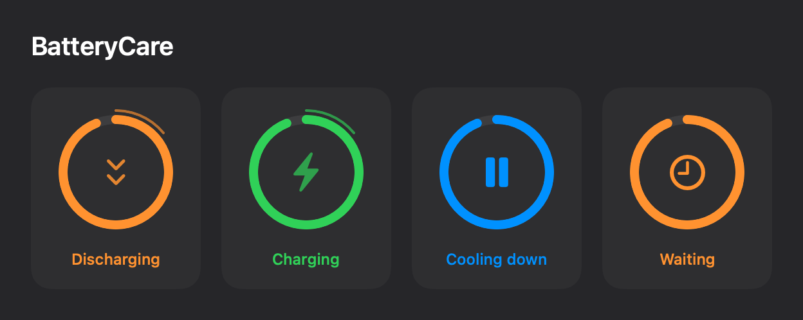

[English](./README.md) · [简体中文](./README.zh-CN.md) · [繁體中文](./README.zh-TW.md) · [日本語](./README.ja.md)

<div align="center">
  
  <h1>BatteryCare</h1>
  <p><strong>电量，一目了然。控制，恰到好处。</strong></p>
  <p>轻盈的原生 macOS 菜单栏电池工具，将状态、温度与电源控制收进一个半透明面板。</p>
  <p>
    
    
    
    
  </p>
  <p>
    <a href="#overview">项目介绍</a> ·
    <a href="#features">功能特性</a> ·
    <a href="#workflows">使用场景</a> ·
    <a href="#quick-start">快速开始</a> ·
    <a href="./docs/SECURITY.md">安全边界</a> ·
    <a href="./docs/DESIGN.md">设计说明</a>
  </p>
</div>

---

<a id="overview"></a>
## ✨ 认识 BatteryCare

不用切换终端，也不用另起一个后台服务。BatteryCare 将电池百分比、实际充电状态、温度、健康度和自动耗电控制整合进原生菜单栏 App，以毛玻璃材质、紧凑卡片与清晰图标呈现。

项目由早期的 `battery.py` 工具演进而来。当前版本使用 Swift actor 在 App 内完成监测与控制循环，通过随附的小型 Go 助手执行需要管理员权限的硬件操作；**运行不依赖 Python、HTTP 服务或另装 LaunchDaemon**。

> **使用边界：** 这不是 Apple 官方应用，也不能保证延长电池寿命。自动耗电会主动增加 CPU 负载、发热与电池循环，不是普通的「充电上限」功能。默认关闭，每次重新打开 App 都保持关闭。请阅读[安全说明](./docs/SECURITY.md)，不要在无人值守或关键任务期间启用。

<a id="features"></a>
## 🚀 功能特性

### 🔋 真实状态，一眼看清

- 菜单栏显示电量，左键打开面板，右键进入快捷开关、设置与退出。
- 闪电仅在系统报告**实际正在充电**时显示，不与自动耗电开关混用。
- 查看电池温度与健康度；传感器不可用时明确呈现，而不是伪造读数。
- 面板跟随菜单栏按钮定位，并限制在当前屏幕可见范围；较短屏幕支持滚动。
- 状态环按实际工作状态变化：自动耗电负载运行时向下流动箭头、充电时闪电、冷却时暂停、等待阈值时时钟。进度始终对应真实电量；动画最高 15 帧/秒，仅在面板可见时运行，支持“减少动态效果”。



### 🎛️ 阈值控制与温度保护

- 自定义开始/停止耗电阈值、温度上限、冷却时间与控制轮询间隔。
- 达到上阈值且传感器可用时，确认适配器已切断后才开启自适应纯 CPU 耗电负载；达到下阈值后停止负载并恢复适配器。
- 最多使用 4 个线程且不超过一半逻辑核心（至少 1 个），逐步加速，每线程目标占空比最高 85%。CPU 实际停止温度取设置值与 75°C 中较低者；系统热压力升高时降载或停止。不额外增加 GPU、磁盘或大内存负载。这是保守的软件预算，不是零损耗保证。
- 电池与温度每 5 秒采样，健康度缓存 5 分钟；安全停止不等待普通阈值轮询间隔。
- 过温、低电量或传感器缺失触发停止或冷却；CPU 工作线程与防睡眠断言具有超时保护。

### 🧩 服务就在 App 里

- 普通用户进程负责界面、监测与负载，管理员权限仅用于随附硬件助手。
- 私有 Unix socket、会话令牌与固定命令集；不开放 HTTP 控制端口。
- 正常退出时停止负载、释放防睡眠断言并尝试恢复适配器；助手也会检测父进程丢失与心跳超时。
- 可迁移本项目旧 `com.local.battery-service` 服务；先备份再停用，不卸载其他 Homebrew 服务。

### 🌏 四种界面语言

- 支持 English、简体中文、繁體中文、日本語。
- 在 **设置 → 语言** 中切换，面板、菜单、提示和窗口标题立即更新，无需重启。
- 首次启动按系统首选语言匹配，无法匹配时使用英语；手动选择后会记住，不会随系统语言变化被覆盖。
- 切换语言不会改变电源控制、自动耗电开关、阈值或未保存的参数。

### 🎨 原生材质与多彩标识

- SwiftUI + AppKit 半透明面板，支持系统外观。
- 原创珍珠白圆角底、多彩电池与白色闪电 Logo，附 SVG、PNG 和 ICNS。
- 首次尽量靠近右侧系统图标，并记住 ⌘ 拖动调整的位置；可通过 **设置 → 菜单栏位置 → 靠右放置** 重置，不重启监测。最终顺序由 macOS 决定，不能保证紧挨原生电池。
- 支持登录时打开；提供原生电池图标设置入口，**隐藏操作由用户在系统设置中完成**。

<a id="workflows"></a>
## 💡 使用场景

| 场景 | 可以完成的操作 |
| --- | --- |
| 日常查看电池 | 从菜单栏查看电量、充电、温度和健康度，无需授权硬件控制。 |
| 手动管理耗电循环 | 了解风险后设置上下阈值，显式授权并启用自动耗电。 |
| 减少菜单栏重复图标 | 打开系统设置，手动隐藏系统自带电池图标。 |
| 从旧 Python 版升级 | 使用设置中的迁移入口备份旧服务，再切换至内置引擎。 |

<a id="quick-start"></a>
## ⚡ 快速开始

### 获取源码并构建

**开发环境：** macOS、Xcode Command Line Tools（提供 Swift 和系统 SDK）、Go 1.25+。构建脚本调用系统 Python 3 生成 plist，**最终 App 无 Python 运行时依赖**。Go 依赖已 vendor，构建不需要在线拉取模块。

```bash
git clone https://github.com/minskiter/BatteryCare.git
cd BatteryCare
./test.sh
./build.sh
open dist/BatteryCare.app
```

当前脚本按本机架构构建，最低系统目标为 macOS 13；不是 Universal Binary。已在 Apple Silicon 主机上构建、运行隔离测试，**未完成 Intel 与全部 macOS 版本的实机兼容验证**。SMC 控制取决于硬件是否暴露支持的键，不支持时应停止控制并报告错误。

构建产物为本地 ad-hoc 签名，未做 Developer ID 签名或公证；不要为了运行下载文件而关闭系统安全检查。跨机器发行前应完成正式签名、公证与目标设备测试。

### 第一次使用

1. 打开 App，点击菜单栏电池图标查看状态。App 不显示 Dock 图标。
2. 需要电源控制时，在设置中选择「迁移／授权电源控制…」，通过系统管理员授权。
3. 核对阈值与温度上限，阅读风险提示后再启用自动耗电；不需要此功能时保持关闭。
4. 若要隐藏原生电池图标，通过设置入口前往系统设置取消显示；菜单位置随 macOS 版本而不同。
5. 关闭设置窗口不会退出 App；菜单中选择「退出」才会停止内置监测并执行清理。

**从 BatteryBar／BatteryCare 2.1 更新：** 先关闭旧版登录启动并正常退出，再替换应用。2.2 统一使用 `com.local.batterycare` bundle ID 和 `~/Library/Application Support/BatteryCare/config.json`，兼容导入有效的旧 BatteryBar 配置及尚未在新版设置的语言和菜单栏位置，不覆盖新版已有偏好，也不恢复自动耗电。将新版安装到最终位置后重新开启其登录启动；新身份不会自动注销旧身份的登录项。不要在运行中移动 App。

<a id="architecture"></a>
## 🏗️ 技术与架构

```text
菜单栏 / 半透明面板（普通用户权限）
              │
      Swift actor 内置引擎
       ├── 系统电池信息 / 内置 iSMC 温度读取
       ├── 阈值策略 / 自适应 CPU 负载 / 防睡眠断言
       └── 令牌鉴权 Unix socket
                     │
           BatteryHardware（管理员权限）
             固定命令 → SMC 适配器控制
```

| 层级 | 技术与职责 |
| --- | --- |
| 界面 | SwiftUI、AppKit、NSStatusItem、锚定 NSPanel |
| 内置引擎 | Swift concurrency、IOKit、电池采样、迟滞控制与生命周期 |
| 硬件助手 | Go、gosmc、私有 socket、父进程检查与恢复租约 |
| 温度工具 | 从随附源码构建的独立 iSMC 可执行文件 |
| 登录与分发 | SMAppService、本机构建与 ad-hoc 签名 |

### 目录结构

```text
Sources/                 # 原生界面、内置引擎、本地化与图标生成器
Resources/Localizations/ # en / zh-Hans / zh-Hant / ja 完整界面文案
Hardware/                # 受限硬件助手、测试与 vendored 依赖（GPL-2.0）
Dependencies/iSMC/        # 独立温度工具的完整源码及依赖（GPL-3.0）
tests/                   # Swift 模型、图标状态、定位与引擎隔离测试
assets/                  # 品牌 Logo：SVG / PNG / ICNS
docs/                    # 安全、设计与开发说明
build.sh                 # 构建自包含 App，不安装系统服务
test.sh                  # 运行 Go race 与 Swift 隔离测试
dist/                    # 本机构建产物，不纳入版本控制
```

<a id="docs"></a>
## 📚 文档与安全边界

| 文档 | 内容 |
| --- | --- |
| [安全说明](./docs/SECURITY.md) | 管理员权限、负载风险、恢复机制与已知限制 |
| [开发指南](./docs/DEVELOPMENT.md) | 构建、测试、配置兼容与分发 |
| [设计说明](./docs/DESIGN.md) | 原创 Logo、原生材质与状态图标语义 |
| [第三方声明](./THIRD_PARTY_NOTICES.md) | 独立可执行文件及 vendored 依赖的许可证 |

**恢复适配器 ≠ 强制充电。** macOS、硬件和其他电池软件仍可能限制充电。恢复逻辑属于软件层面的尽力保证，无法覆盖断电、硬件故障或助手同时被强制终止等情况。不建议与其他主动控制适配器的工具同时启用。

<a id="contributing"></a>
## 🤝 参与贡献

欢迎提交 Issues 与 Pull Requests。提交前运行 `./test.sh` 与 `./build.sh`，说明设备架构、macOS 版本、变更范围与验证方法。新增界面文案须同步更新四种语言资源和 README；涉及硬件控制的变更必须描述失败处理与恢复行为；自动化测试应使用 mock，不能在 CI 中写入真实 SMC。

不要提交个人配置、管理员密码、会话令牌、运行日志、证书私钥或签名凭据。问题反馈应先脱敏。详见[贡献指南](./CONTRIBUTING.md)。

## 📄 许可证与致谢

第一方 Swift 应用、文档与原创品牌素材以 [GPL-3.0-or-later](./LICENSE) 发布；`Hardware/` 助手保留其 [GPL-2.0](./Hardware/LICENSE) 许可，`Dependencies/iSMC/` 与各 vendor 目录遵循各自许可证，详见[第三方声明](./THIRD_PARTY_NOTICES.md)。它们是分开构建、通过 IPC 或子进程调用的程序，不应将整个源码树标记为单一 MIT 许可。

感谢 [gosmc](https://github.com/charlie0129/gosmc) 与 [iSMC](https://github.com/dkorunic/iSMC) 项目。视觉取向借鉴 macOS 原生材质与 BetterDisplay 的菜单栏交互，未使用 Apple 或 BetterDisplay 的商标图形及源码；项目与它们无隶属关系。

### 自动耗电期间保持屏幕亮起

耗电开关开启且电量、温度监测正常时，临时防止因闲置熄屏及系统闲置睡眠，等待上阈值期间也适用。不会点亮已经熄灭的屏幕、伪装接通电源、修改全局电源设置或覆盖合盖／手动／紧急睡眠。低电量、冷却、传感器失效、关闭开关、助手断连及退出会解除保亮；监测卡住时，系统断言在 15 秒后自动到期。切断适配器后，不保证合盖外接显示器继续工作。耗电时请保持开盖；需要合盖外接显示器时，请关闭自动耗电并保留真实外部供电。

### 本地电量统计（2.3）

从面板底部或菜单栏右键菜单进入「电量统计」，按 24 小时、7 天或 30 天查看观测累计耗电、平均耗电速度、已观测时长、循环次数变化和电量曲线。健康度曲线独立使用最长 180 天的每日均值，不随耗电时段选择改变。支持导出 CSV 和确认后清空历史。

复用现有监测快照，每次运行每分钟最多一条，保存在 `~/Library/Application Support/BatteryCare/history.sqlite3`（权限 0600），每日清理约 365 天以前的记录；不上传、不回填未采集历史。睡眠、App 重启、读数缺失及超过 3 分钟的空档不作为连续观测。累计耗电以「百分点」估计，不是 Wh 能量、额定寿命或终身实际循环数；平均速度至少需要 15 分钟且 2 个百分点的已观测纯电池耗电。统计存储失败不影响电池安全控制。

低于 80% 的预测为保守、未经实机长期验证的趋势启发式：至少跨度 28 天、14 个健康度观测日、2 个百分点下降，完整及前后半段回归均须稳定下降，并排除长空档或明显向上校准。持平、回升、过期或不稳定时不显示日期。情景区间以首个低于 80% 的整数读数 79% 为目标，**不是置信区间或保证，也不是主动加速损耗的依据**。循环次数回退会重新开始拟合健康度趋势。
