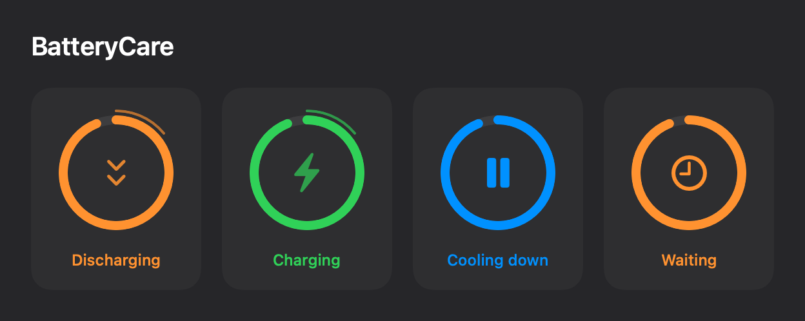

[English](./README.md) · [简体中文](./README.zh-CN.md) · [繁體中文](./README.zh-TW.md) · [日本語](./README.ja.md)

<div align="center">
  
  <h1>BatteryCare</h1>
  <p><strong>電量，一目瞭然。控制，恰到好處。</strong></p>
  <p>輕盈的原生 macOS 選單列電池工具，將狀態、溫度與電源控制收進一個半透明面板。</p>
  <p>
    
    
    
    
  </p>
  <p>
    <a href="#overview">項目介紹</a> ·
    <a href="#features">功能特性</a> ·
    <a href="#workflows">使用場景</a> ·
    <a href="#quick-start">快速開始</a> ·
    <a href="./docs/SECURITY.md">安全邊界</a> ·
    <a href="./docs/DESIGN.md">設計說明</a>
  </p>
</div>

---

<a id="overview"></a>
## ✨ 認識 BatteryCare

不用切換終端，也不用另起一個後台服務。BatteryCare 將電池百分比、實際充電狀態、溫度、健康度和自動耗電控制整合進原生選單列 App，以毛玻璃材質、緊湊卡片與清晰圖示呈現。

項目由早期的 `battery.py` 工具演進而來。目前版本使用 Swift actor 在 App 內完成監測與控制循環，通過隨附的小型 Go 助手執行需要管理員權限的硬體操作；**執行不相依套件 Python、HTTP 服務或另裝 LaunchDaemon**。

> **使用邊界：** 這不是 Apple 官方應用，也不能保證延長電池壽命。自動耗電會主動增加 CPU 負載、發熱與電池循環，不是普通的「充電上限」功能。預設關閉，每次重新打開 App 都保持關閉。請閱讀[安全說明](./docs/SECURITY.md)，不要在無人值守或關鍵任務期間啓用。

<a id="features"></a>
## 🚀 功能特性

### 🔋 真實狀態，一眼看清

- 選單列顯示電量，左鍵打開面板，右鍵進入快捷開關、設定與結束。
- 閃電僅在系統報告**實際正在充電**時顯示，不與自動耗電開關混用。
- 查看電池溫度與健康度；傳感器不可用時明確呈現，而不是偽造讀數。
- 面板跟隨選單列按鈕定位，並限制在目前屏幕可見範圍；較短屏幕支持滾動。
- 狀態環依實際工作狀態變化：自動耗電負載執行時向下流動箭頭、充電時閃電、冷卻時暫停、等待門檻時時鐘。進度始終對應真實電量；動畫最高每秒 15 幀，僅在面板可見時執行，支援「減少動態效果」。



### 🎛️ 門檻控制與溫度保護

- 自定義開始/停止耗電門檻、溫度上限、冷卻時間與控制輪詢間隔。
- 達到上門檻且傳感器可用時，確認電源轉接器已切斷後才開啓自適應純 CPU 耗電負載；達到下門檻後停止負載並恢復電源轉接器。
- 最多使用 4 個執行緒且不超過一半邏輯核心（至少 1 個），逐步加速，每執行緒目標占空比最高 85%。CPU 實際停止溫度取設定值與 75°C 中較低者；系統熱壓力升高時降載或停止。不額外增加 GPU、磁碟或大記憶體負載。這是保守的軟體預算，不是零損耗保證。
- 電池與溫度每 5 秒採樣，健康度緩存 5 分鐘；安全停止不等待普通門檻輪詢間隔。
- 過溫、低電量或傳感器缺失觸發停止或冷卻；CPU 工作執行緒與防睡眠斷言具有超時保護。

### 🧩 服務就在 App 里

- 普通用戶進程負責界面、監測與負載，管理員權限僅用於隨附硬體助手。
- 私有 Unix socket、會話令牌與固定命令集；不開放 HTTP 控制端口。
- 正常結束時停止負載、釋放防睡眠斷言並嘗試恢復電源轉接器；助手也會檢測父進程丟失與心跳超時。
- 可遷移本項目舊 `com.local.battery-service` 服務；先備份再停用，不卸載其他 Homebrew 服務。

### 🌏 四種界面語言

- 支持 English、簡體中文、繁體中文、日本語。
- 在 **設定 → 語言** 中切換，面板、選單、提示和視窗標題立即更新，無需重啓。
- 首次啟動按系統首選語言匹配，無法匹配時使用英語；手動選擇後會記住，不會隨系統語言變化被覆蓋。
- 切換語言不會改變電源控制、自動耗電開關、門檻或未儲存的參數。

### 🎨 原生材質與多彩標誌

- SwiftUI + AppKit 半透明面板，支持系統外觀。
- 原創珍珠白圓角底、多彩電池與白色閃電 Logo，附 SVG、PNG 和 ICNS。
- 首次盡量靠近右側系統圖示，並記住 ⌘ 拖移調整的位置；可透過 **設定 → 選單列位置 → 靠右放置** 重設，不重啟監測。最終順序由 macOS 決定，無法保證緊鄰原生電池。
- 支持登入時打開；提供原生電池圖示設定入口，**隱藏操作由用戶在系統設定中完成**。

<a id="workflows"></a>
## 💡 使用場景

| 場景 | 可以完成的操作 |
| --- | --- |
| 日常查看電池 | 從選單列查看電量、充電、溫度和健康度，無需授權硬體控制。 |
| 手動管理耗電循環 | 瞭解風險後設定上下門檻，明確授權並啓用自動耗電。 |
| 減少選單列重復圖示 | 打開系統設定，手動隱藏系統自帶電池圖示。 |
| 從舊 Python 版升級 | 使用設定中的遷移入口備份舊服務，再切換至內建引擎。 |

<a id="quick-start"></a>
## ⚡ 快速開始

### 獲取原始碼並建置

**開發環境：** macOS、Xcode Command Line Tools（提供 Swift 和系統 SDK）、Go 1.25+。建置指令稿調用系統 Python 3 生成 plist，**最終 App 無 Python 執行時相依套件**。Go 相依套件已 vendor，建置不需要在線拉取模組。

```bash
git clone https://github.com/minskiter/BatteryCare.git
cd BatteryCare
./test.sh
./build.sh
open dist/BatteryCare.app
```

目前指令稿按本機架構建置，最低系統目標為 macOS 13；不是 Universal Binary。已在 Apple Silicon 主機上建置、執行隔離測試，**未完成 Intel 與全部 macOS 版本的實機兼容驗證**。SMC 控制取決於硬體是否暴露支持的鍵，不支持時應停止控制並報告錯誤。

建置產物為本地 ad-hoc 簽署，未做 Developer ID 簽署或公證；不要為了執行下載文件而關閉系統安全檢查。跨機器發行前應完成正式簽署、公證與目標設備測試。

### 第一次使用

1. 打開 App，點擊選單列電池圖示查看狀態。App 不顯示 Dock 圖示。
2. 需要電源控制時，在設定中選擇「遷移／授權電源控制…」，通過系統管理員授權。
3. 核對門檻與溫度上限，閱讀風險提示後再啓用自動耗電；不需要此功能時保持關閉。
4. 若要隱藏原生電池圖示，通過設定入口前往系統設定取消顯示；選單位置隨 macOS 版本而不同。
5. 關閉設定視窗不會結束 App；選單中選擇「結束」才會停止內建監測並執行清理。

**從 BatteryBar／BatteryCare 2.1 更新：** 先關閉舊版登入啟動並正常結束，再替換應用程式。2.2 統一使用 `com.local.batterycare` bundle ID 和 `~/Library/Application Support/BatteryCare/config.json`，相容匯入有效的舊 BatteryBar 設定及尚未在新版設定的語言和選單列位置，不覆蓋新版已有偏好，也不恢復自動耗電。將新版安裝到最終位置後重新開啟其登入啟動；新身分不會自動取消舊身分的登入項。不要在執行中移動 App。

<a id="architecture"></a>
## 🏗️ 技術與架構

```text
選單列 / 半透明面板（普通用戶權限）
              │
      Swift actor 內建引擎
       ├── 系統電池信息 / 內建 iSMC 溫度讀取
       ├── 門檻策略 / 自適應 CPU 負載 / 防睡眠斷言
       └── 令牌鑒權 Unix socket
                     │
           BatteryHardware（管理員權限）
             固定命令 → SMC 電源轉接器控制
```

| 層級 | 技術與職責 |
| --- | --- |
| 界面 | SwiftUI、AppKit、NSStatusItem、錨定 NSPanel |
| 內建引擎 | Swift concurrency、IOKit、電池採樣、遲滯控制與生命週期 |
| 硬體助手 | Go、gosmc、私有 socket、父進程檢查與恢復租約 |
| 溫度工具 | 從隨附原始碼建置的獨立 iSMC 可執行文件 |
| 登入與分發 | SMAppService、本機建置與 ad-hoc 簽署 |

### 目錄結構

```text
Sources/                 # 原生界面、內建引擎、本地化與圖示生成器
Resources/Localizations/ # en / zh-Hans / zh-Hant / ja 完整界面文案
Hardware/                # 受限硬體助手、測試與 vendored 相依套件（GPL-2.0）
Dependencies/iSMC/        # 獨立溫度工具的完整原始碼及相依套件（GPL-3.0）
tests/                   # Swift 模型、圖示狀態、定位與引擎隔離測試
assets/                  # 品牌 Logo：SVG / PNG / ICNS
docs/                    # 安全、設計與開發說明
build.sh                 # 建置自包含 App，不安裝系統服務
test.sh                  # 執行 Go race 與 Swift 隔離測試
dist/                    # 本機建置產物，不納入版本控制
```

<a id="docs"></a>
## 📚 文件與安全邊界

| 文檔 | 內容 |
| --- | --- |
| [安全說明](./docs/SECURITY.md) | 管理員權限、負載風險、恢復機制與已知限制 |
| [開發指南](./docs/DEVELOPMENT.md) | 建置、測試、配置兼容與分發 |
| [設計說明](./docs/DESIGN.md) | 原創 Logo、原生材質與狀態圖示語義 |
| [第三方聲明](./THIRD_PARTY_NOTICES.md) | 獨立可執行文件及 vendored 相依套件的授權條款 |

**恢復電源轉接器 ≠ 強制充電。** macOS、硬體和其他電池軟體仍可能限制充電。恢復邏輯屬於軟體層面的盡力保證，無法覆蓋斷電、硬體故障或助手同時被強制終止等情況。不建議與其他主動控制電源轉接器的工具同時啓用。

<a id="contributing"></a>
## 🤝 參與貢獻

歡迎提交 Issues 與 Pull Requests。提交前執行 `./test.sh` 與 `./build.sh`，說明設備架構、macOS 版本、變更範圍與驗證方法。新增界面文案須同步更新四種語言資源和 README；涉及硬體控制的變更必須描述失敗處理與恢復行為；自動化測試應使用 mock，不能在 CI 中寫入真實 SMC。

不要提交個人配置、管理員密碼、會話令牌、執行日誌、證書私鑰或簽署憑據。問題反饋應先脫敏。詳見[貢獻指南](./CONTRIBUTING.md)。

## 📄 授權條款與致謝

第一方 Swift 應用、文檔與原創品牌素材以 [GPL-3.0-or-later](./LICENSE) 發佈；`Hardware/` 助手保留其 [GPL-2.0](./Hardware/LICENSE) 許可，`Dependencies/iSMC/` 與各 vendor 目錄遵循各自授權條款，詳見[第三方聲明](./THIRD_PARTY_NOTICES.md)。它們是分開建置、通過 IPC 或子進程調用的程序，不應將整個原始碼樹標記為單一 MIT 許可。

感謝 [gosmc](https://github.com/charlie0129/gosmc) 與 [iSMC](https://github.com/dkorunic/iSMC) 項目。視覺取向借鑒 macOS 原生材質與 BetterDisplay 的選單列交互，未使用 Apple 或 BetterDisplay 的商標圖形及原始碼；項目與它們無隸屬關係。

### 自動耗電期間保持螢幕亮起

耗電開關開啟且電量、溫度監測正常時，暫時防止閒置熄屏及系統閒置睡眠，等待上閾值期間亦適用。不會點亮已熄滅的螢幕、偽裝接通電源、修改全域電源設定或覆蓋闔蓋／手動／緊急睡眠。低電量、冷卻、感測器失效、關閉開關、助手斷線及退出會解除保亮；監測停滯時，系統斷言於 15 秒後到期。切斷變壓器後，不保證闔蓋外接顯示器繼續運作。耗電時請保持開蓋；需要闔蓋外接顯示器時，請關閉自動耗電並保留真實外部供電。
